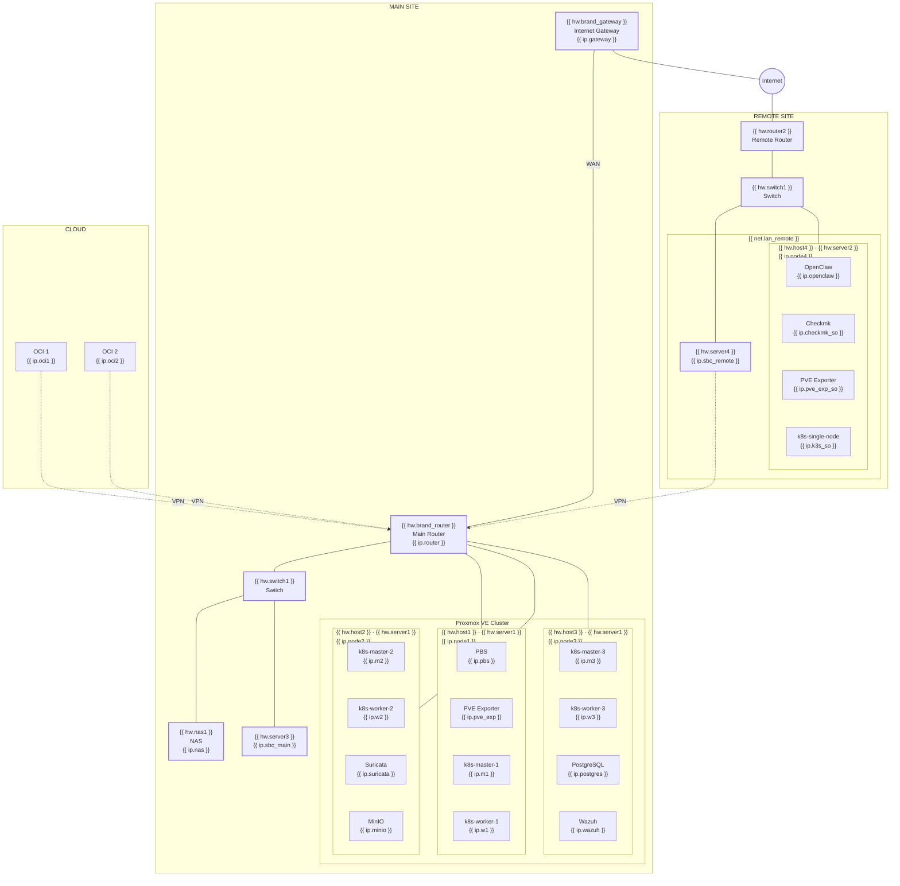

# Architecture

## Infrastructure architecture

**Legend**

<ul class="forbay-legend">
  <li> Bare metal</li>
  <li> Virtual machine</li>
  <li> Container</li>
  <li> Network device</li>
</ul>

See [Network](3-network.md) for the full network topology.
