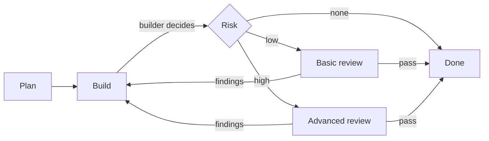

# AI

> How AI access is leveraged and governed.

## Overview

| Tool | Runs on | Model support | Secret Access Scope | Purpose |
| :--- | :--- | :--- | :--- | :--- |
| [OpenCode](https://github.com/anomalyco/opencode) | workstation, local shell | local and cloud open-weight models | Restricted by built-in command approval | interactive agent, supervised |
| [OpenClaw](https://github.com/openclaw/openclaw) | unprivileged container on Forbay infrastructure | local and cloud open-weight models | Restricted strictly to its own runtime secrets | unattended agent, remote |
| [Gemini](https://gemini.google.com/) | cloud | Google models | No access to secrets | AI chat assistant with documentation context |
| [ChatGPT](https://chatgpt.com/) | cloud | OpenAI models | No access to secrets | AI chat assistant with documentation context and [GitHub mirror](4-iac.md#version-control) read-only repositories access |

## OpenCode

| Item | Value |
| :--- | :--- |
| Host | my workstation |
| Identity | my own user |
| Reach | same as the machine |
| Config | git repo, auto-sync on changes, secrets excluded |
| Guardrail | built-in command approval; run only when supervised |

### OpenCode Workflow

OpenCode works in three stages: plan the change, build it, then review it. The depth of the review follows the risk of the change.

| Agent | Role |
| :--- | :--- |
| Planner | Explores and proposes the change, read-only |
| Builder | Makes the change and decides the review level |
| Reviewer | Checks the change, basic or advanced |

### OpenCode access

| Target | Method | Rights |
| :--- | :--- | :--- |
| Hosts | SSH | my user, my sudo |
| Proxmox | API / SSH | my credentials |
| Kubernetes | `kubectl` | my kubeconfig |
| Repositories | git | my credentials |

## OpenClaw

| Item | Value |
| :--- | :--- |
| Host | unprivileged LXC on `{{ hw.host4 }}`, remote site |
| Identity | `openclaw`, no sudo |
| Network | SO flat LAN, `.16/29` of `{{ net.trusted }}`; main-site firewall applies VLAN 40 rules |
| Reach | SSH with a public key |
| Config | git repo, auto-sync on changes, secrets excluded |

### OpenClaw access

| Target | Method | Rights |
| :--- | :--- | :--- |
| Linux Hosts | SSH | `openclaw`, no sudo; `adm` + `systemd-journal` |
| `{{ hw.router3 }}` | SSH | group `openclaw` (can read everything excluding sensitive data like private keys and launch scripts) |
| Proxmox | API token | `PVEAuditor` |
| Kubernetes | SA `rbac:openclaw` | `get`/`list`/`watch` only. secrets excluded. |
| Repositories | deploy key | read and write access on git repositories |

#### OpenClaw allowed infrastructure change access paths

| Change | How |
| :--- | :--- |
| Linux Hosts | commit `ansible-config`, trigger its pipeline with pipeline trigger token; the privileged SSH user private key and vaulted secrets decryption can't be accessed directly by openclaw |
| Kubernetes | commit the `argocd` gitops repo; ArgoCD syncs it |
