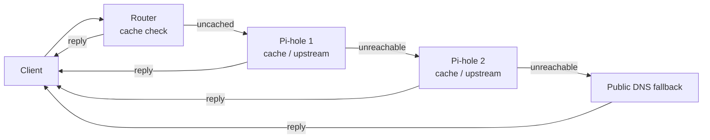

# Network

> It's not DNS. There's no way it's DNS. It was DNS.

### Network diagram

[Open the network diagram]({{ links.diagram }})

## Main Site

### Network Overview
- **Router 1 — {{ hw.brand_gateway }} (Internet Gateway):** `{{ ip.gateway }}`  
- **Router 2 — {{ hw.brand_router }} (Exposed Host):** `{{ ip.router }}` (connected to {{ hw.brand_gateway }} via `ether1`)  
- Internal VLAN routing and segmentation is handled by {{ hw.brand_router }}.

### Subnets

| Network / Subnet    | Description                    | IP Allocation Range             |
| :---                | :---                           | :---                           |
| {{ net.lan_main }}   | Home LAN / {{ hw.brand_gateway }} network    | DHCP: .2-.254                 |
| {{ net.mgmt }}       | Management VLAN subnet         | Static: .2 - .99, DHCP: .100 - .254 |
| {{ net.vpn }}       | VPN subnet (WireGuard clients) | Static: .2 - .99, DHCP: .100 - .254 |
| {{ net.storage }}       | Storage VLAN subnet            | Static: .2 - .99, DHCP: .100 - .254 |
| {{ net.trusted }}       | Trusted VLAN subnet            | Static: .2 - .15, **Remote site: .16-.23**, DHCP: .100 - .254 |
| {{ net.untrusted }}       | Untrusted VLAN subnet          | Static: .2 - .99, DHCP: .100 - .254 |
| {{ net.k8s }}       | Kubernetes VLAN subnet         | Static: .2 - .15, **Remote site: .16-.23**, DHCP: .100 - .254 |

### VLAN Definitions

| VLAN ID | VLAN Name       | Description                    |
| :---    | :---            | :---                           |
| 10      | Management      | Management network VLAN        |
| 30      | Storage         | Storage VLAN                   |
| 40      | Trusted         | Trusted devices VLAN           |
| 50      | Untrusted       | Guest / untrusted VLAN         |
| 60      | Kubernetes      | Kubernetes cluster VLAN        |

### VLAN Interfaces on {{ hw.brand_router }}

| VLAN ID | {{ hw.brand_router }} Interface        |
| :---    | :---                      |
| 10      | vlan10-mgmt               |
| 30      | vlan30-storage            |
| 40      | vlan40-trusted            |
| 50      | vlan50-untrusted          |
| 60      | vlan60-k8s                |
| -       | forbay-wg (WireGuard VPN) |

---

### {{ hw.brand_router }} Bridge Port VLAN Roles

| Interface | Role         | VLAN Access / Trunk                     | Description                           |
| :---      | :---         | :---                                  | :---                                |
| ether1    | WAN          | Connected to {{ hw.brand_gateway }} (`{{ ip.gateway }}`) | WAN port, untagged on `{{ ip.router }}` |
| ether2    | Access Port  | VLAN30 untagged (PVID=30)              | Storage VLAN access for NAS |
| ether3    | Trunk Port   | All VLANs tagged allowed               | Trunk to Proxmox nodes or switches   |
| ether4    | Trunk Port   | All VLANs tagged allowed               | Trunk to Proxmox nodes or switches   |
| ether5    | Trunk Port   | All VLANs tagged allowed               | Trunk to Proxmox nodes or switches   |

---

### Notes
- **Access ports** accept only untagged frames for their respective VLANs. Devices connected here belong to the respective VLAN by default.
- **Trunk ports** accept only tagged VLAN frames and forward all VLANs to connected devices such as Proxmox nodes or managed switches.
- VLAN tagging is performed by {{ hw.brand_router }} on trunk ports; devices connected to trunk ports **must support VLAN tagging** to properly handle traffic.
- The {{ hw.brand_gateway }} remains the gateway on the `{{ net.lan_main }}` network and connects upstream via `ether1` on {{ hw.brand_router }}.

### Remote Access

| Method | Detail |
| :--- | :--- |
| **WireGuard VPN** | {{ hw.brand_router }} WireGuard server (`forbay-wg` interface). |

---

## Remote Site

### Network Overview

- **Router 3 — {{ hw.router2 }}**: only router at remote site. No exposed host.

### Subnets

| Network | Description |
| :--- | :--- |
| `{{ net.lan_main }}` | Home LAN  |
| `{{ net.lan_remote }}` | {{ hw.brand_gateway }} guest network, isolated for homelab remote site |

### Static IP Reservations for Remote Site Machines

Machines running on {{ hw.host4 }} (SO site) are connected via WireGuard to the main site's
internal subnets. They use statically-reserved IPs in the `.16-.23` range to
avoid DHCP conflicts:

| Subnet | Reserved | Purpose | Current hosts |
|--------|----------|---------|---------------|
| `{{ net.trusted }}` | `.16/28` | SO site services (OpenClaw, etc.) | `.18` = openclaw-forbay CT |
| `{{ net.k8s }}` | `.16/28` | SO site K3s nodes | `.18` = forbay-k8s-so-master-1 CT |

These IPs are advertised via Tailscale subnet routing ({{ hw.host4 }}'s routes: `{{ net.remote_trusted }}`, `{{ net.remote_k8s }}`).

### Remote Access

| Tool | Purpose |
| :--- | :--- |
| **Tailscale** | VPN for remote site + selected main site hosts. Backup access if WireGuard is down. |
| **Cloudflare Proxy + Tunnel** | Outbound QUIC tunnel bypassing CGNAT. Same WAF/DDoS as Main site. |

## DNS

Pi-hole provides ad-blocking and local DNS caching across the network. The design ensures DNS resolution remains available even if both Pi-hole instances go down. Pi-hole uses DoH for upstream DNS queries. 

### Pi-hole Instances

| Instance | IP Address | Location | Role |
| :--- | :--- | :--- | :--- |
| Pi-hole 1 | `{{ ip.dns1 }}` | Main site | Primary DNS server |
| Pi-hole 2 | `{{ ip.dns2 }}` | Remote site | Secondary DNS server |

### Fallback Design

The {{ hw.brand_router }} router is configured with the two Pi-hole IPs as upstream DNS servers. If **both** Pi-hole instances become unreachable, the {{ hw.brand_router }} falls back to public DNS resolvers:

| Fallback | IPv4 | IPv6 |
| :--- | :--- | :--- |
| Google | `8.8.8.8` / `8.8.4.4` | `2001:4860:4860::8888` / `2001:4860:4860::8844` |
| Cloudflare | `1.1.1.1` / `1.0.0.1` | `2606:4700:4700::1111` / `2606:4700:4700::1001` |

### DNS Resolution Flow

