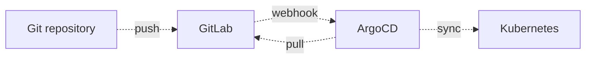

# IaC, Automation & GitOps

> Git is the single source of truth.

## Infrastructure as Code

This section outlines the approach used for provisioning virtual machines using Infrastructure as Code (IaC) principles.

### Base Template

| Step | Description |
| :--- | :--- |
| **1. Manual Install** | A minimal Linux distribution is first installed manually and then configured using Ansible. |
| **2. Template Conversion** | The VM is converted into a reusable **base template**, available to all PVE nodes though NFS share. |
| **3. IaC Usage** | This template becomes the foundation for all future VM provisioning through OpenTofu. |
| **4. Template local cache (optional)** | The base template is cloned into local storage of all PVE nodes, allowing faster clones instead of relying on slower NFS (and preventing concurrent access locks). |

---

### Provisioning & Configuration Flow

| Stage | Tool | Responsibility |
| :--- | :--- | :--- |
| **Base Template** | — | A Linux distro is manually installed once and converted into a reusable VM template. |
| **Provisioning** | **OpenTofu** | Creates and manages VMs from the base template. |
| **Initial Setup** | **Cloud-Init** | Handles early configuration such as IP assignment, user creation, and SSH key injection. |
| **Configuration** | **Ansible** | Day-2 host configuration; not part of cluster bootstrap. |

---

## Automation

Ansible handles day-2 host configuration only: baseline, packages, NFS, log/metrics agents, and updates.
Roles are flag-gated per host/group, idempotent, and targeted with `--limit` or `--tags`.

---

## GitOps & Continuous Delivery

After provisioning the base Kubernetes cluster with **OpenTofu**, everything else is managed with **ArgoCD** using GitOps. The initial ArgoCD setup is a bootstrap script that needs to be launched manually. After applying the bootstrap script, everything else is managed from ArgoCD — even ArgoCD itself — and the repository becomes the source of truth for the entire cluster.

---

## Version Control

| Tool | Role | Notes |
| :--- | :--- | :--- |
| **GitLab** | Primary repository | Hosts IaC (OpenTofu), day-2 host configuration (Ansible), and ArgoCD configuration, plus these docs. |
| **GitHub** | Mirror repository | Automatically synced from GitLab for redundancy and visibility. |
