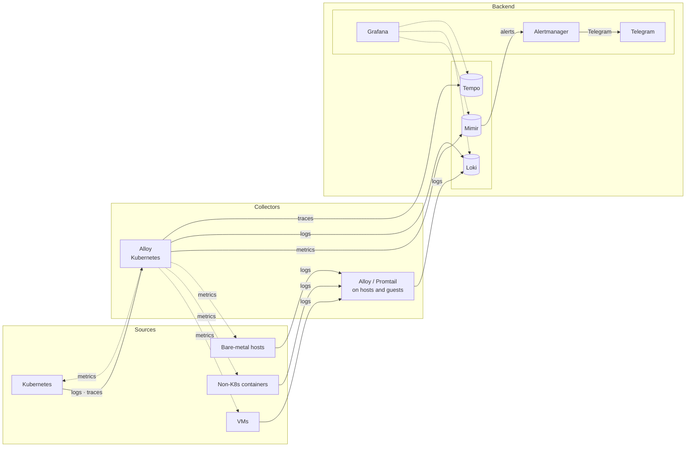

# Observability

> Storing 500GB of debug logs just to search `grep "error"` twice a year.

## Monitoring

| # | Place | Purpose | Tools | Flow |
| :--- | :--- | :--- | :--- | :--- |
| 1 | External | Uptime checks | [Uptime Kuma](https://github.com/louislam/uptime-kuma) | Active PING/HTTP |
| 2 | External | Dead man's switch | [Healthchecks.io](https://healthchecks.io/) | Heartbeat push |
| 3 | Internal | Host/service monitoring | [CheckMK](https://github.com/Checkmk/checkmk) | Agent → Checkmk server |
| 4 | Internal | Metrics & alerting | Alloy, Mimir, Alertmanager | Alloy → Mimir → Alertmanager |
| 5 | Internal | PVE/PBS job status | Proxmox | Webhook |
| 6 | External | Cronjob liveness | [Healthchecks.io](https://healthchecks.io/) | Heartbeat push |

### Alerting Flow

| Source | Scope | Channel | Route |
| :--- | :--- | :--- | :--- |
| Mimir ruler | Metrics, K8s health | `@Forbay Alerts` | Alertmanager → Telegram API |
| Healthchecks.io | Dead man's switch | `@Forbay Healthchecks` | Telegram API |
| Uptime Kuma | Service downtime | `@Forbay Uptime` | Telegram API |
| PVE / PBS | Job/task status | `@Forbay Alerts` | Telegram API |

***

## Stack

### Component overview

#### Metrics

| Component | Function | Mechanism |
| :--- | :--- | :--- |
| **Alloy** | Metrics agent | Scrapes Kubernetes and exporters → Mimir. |
| **Mimir** | Metrics store | Receives remote writes; ruler → Alertmanager. |

#### Logs

| Component | Function | Mechanism |
| :--- | :--- | :--- |
| **Alloy** | Log agent | Collects K8s and host journals → Loki. |
| **Promtail** | Log agent (32-bit) | Collects host journals → Loki. |
| **Loki** | Log store | Receives pushes from agents. |

#### Traces

| Component | Function | Mechanism |
| :--- | :--- | :--- |
| **Alloy** | Tracing agent | Receives OTLP + Jaeger → Tempo. |
| **Tempo** | Trace store | Receives traces from Alloy. |

#### Visualization

| Component | Function | Mechanism |
| :--- | :--- | :--- |
| **Grafana** | UI | All stores, Alertmanager, Wazuh. |
