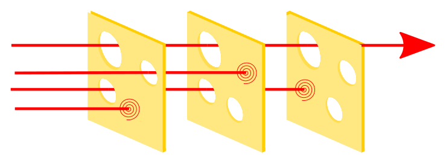

# Security

> No Swiss cheese was harmed in the making of this architecture.

The security strategy is multi-layered, focusing on perimeter defense, network segmentation, visibility and threat prevention and detection, to protect the whole infrastructure.

Each layer acts as a slice of Swiss cheese; the goal is to ensure that the individual holes (vulnerabilities) in these multiple layers never align, preventing a threat from creating an uninterrupted path to an exploit.

***

### Network Security

The defense combines strict firewalling with internal network isolation using VLANs to enforce a "default-deny" approach.

#### External Access

| Security Layer | Site | Component | Status | Mechanism | Goal |
| :--- | :--- | :--- | :--- | :--- | :--- |
| **Public Web Access** | Main | **Cloudflare Proxy + Firewall** | 🟢 | HTTPS proxied via Cloudflare; firewall only allows Cloudflare IP ranges → :443 | Perimeter defense + DDoS/WAF |
| **Public Web Access** | DR | **Cloudflare Tunnel** | 🟢 | Outbound QUIC tunnel to Cloudflare, bypassing carrier-grade NAT (CGNAT) | Same Cloudflare WAF/DDoS protection without a public IP |

#### Internal Isolation

| Security Layer | Component | Status | Mechanism | Goal |
| :--- | :--- | :--- | :--- | :--- |
| **VLAN Segmentation** | **Network Zoning** | 🟢 | Physical network logically divided into separate broadcast domains (Mgmt, K8s, Storage, etc.). | Limits the **blast radius** of a compromise. |
| **VLAN Isolation** | **Firewall Enforcement** | 🟢 | **Default Deny** policy: all traffic between zones is blocked unless explicitly permitted. | Enforces a strict **Zero-Trust** security posture. |

---

#### Network Intrusion Detection/Prevention (IDS/IPS)

| Security Layer | Component | Status | Mechanism | Goal |
| :--- | :--- | :--- | :--- | :--- |
| **Network Visibility** | **Suricata** | 🟢 | Router sends periodically .pcap exports to Suricata. Suricata analyze alerts, which are visible in SIEM dashboard. | Detect and, eventually, prevent known malicious traffic patterns. |

---

### Security Information and Event Management (SIEM)

| Security Layer | Component | Status | Mechanism | Goal |
| :--- | :--- | :--- | :--- | :--- |
| **Host Monitoring/SIEM** | **Wazuh** | 🟢 | **Log and Security Event Aggregation** from endpoints for centralized monitoring and correlation. | SIEM |

### Hypervisor Security

| Security Layer | Component | Status | Mechanism | Goal |
| :--- | :--- | :--- | :--- | :--- |
| **System Patching** | **Automated Upgrades** | 🟢 | Configuration of **unattended-upgrades** to automatically apply security patches and kernel updates to Proxmox hosts. | Reduces the **attack surface** by ensuring vulnerabilities are patched without manual intervention. |

### NAS Security

| Security Layer | Component | Status | Mechanism | Goal |
| :--- | :--- | :--- | :--- | :--- |
| **System Patching** | **Automated Upgrades** | 🟢 | Configuration of automated upgrades to automatically apply security patches. | Reduces the attack surface by ensuring vulnerabilities are patched without manual intervention. |
| **File Protection** | **{{ hw.brand_nas }} Malware Remover** | 🟢 | Daily scanning of stored files and system areas to detect malware, ransomware traces, and abnormal behaviors. | Early detection and mitigation of malicious files or anomalies within NAS data. |

### VM Security

| Security Layer | Component | Status | Mechanism | Goal |
| :--- | :--- | :--- | :--- | :--- |
| **System Patching** | **Automated Upgrades** | 🟢 | Configuration of **unattended-upgrades** to automatically apply security patches. | Reduces the **attack surface** by ensuring vulnerabilities are patched without manual intervention. |

### Kubernetes Security

| Security Layer | Component | Status | Mechanism | Goal |
| :--- | :--- | :--- | :--- | :--- |
| **Cluster Patching** | **K3s Upgrade Controller** | 🟢 | Automated rolling updates of K3s control plane and agent nodes. | Reduces the **attack surface** by patching Kubernetes CVEs safely and sequentially. |
| **Secret Management** | **Bitwarden Secrets Operator** | 🟢 | Inject secrets into Kubernetes from a central, secure vault. | Prevents sensitive data from being committed to the Git repository (Secret zero issue). |
| **Runtime Vulnerability Scan** | **Trivy Operator** | 🟢 | Scans **running container images** and configurations directly within the cluster. | Identifies and reports vulnerabilities in workloads currently exposed in the production environment. |
| **Image Vulnerability Scan** | **Trivy Harbor Scanner** | 🟢 | Scans **stored container images** in the private registry (Harbor) upon push. | Prevents known vulnerable images from being deployed into the cluster (Shift Left Security). |
| **Network Segmentation** | **Cilium Network Policies** | 🟢 | Enforces **Default-Deny** policy for traffic between namespaces (pod-to-pod). | Limits lateral movement and the **blast radius** of a compromise. |
| **Pod Network Encryption** | **Cilium WireGuard** | 🟢 | L3/L4 kernel encapsulation via `cilium_wg0` | Encrypt cross-node packet payload in transit |
| **Workload Identity** | **Cilium mTLS** | 🟢 | SPIFFE SVID verification via SPIRE; mTLS enforced on cross-namespace ingress rules with kube-system exempt for bootstrapping | Authorize TCP streams based on service identity |
